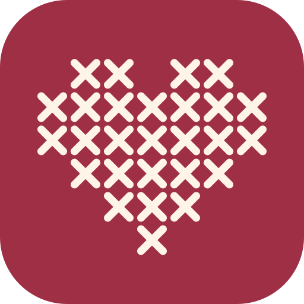
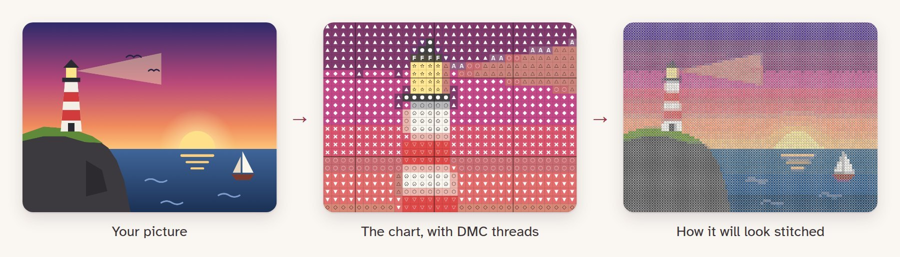
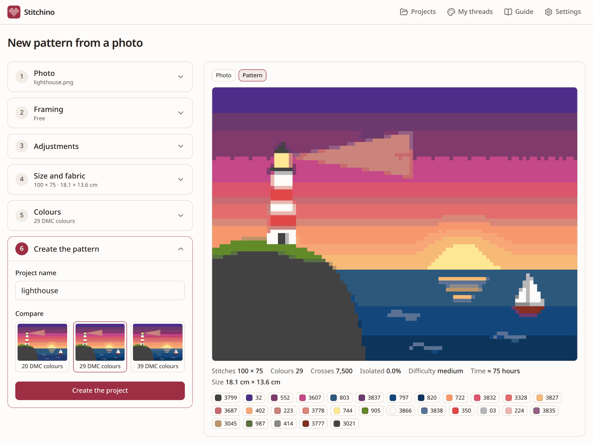
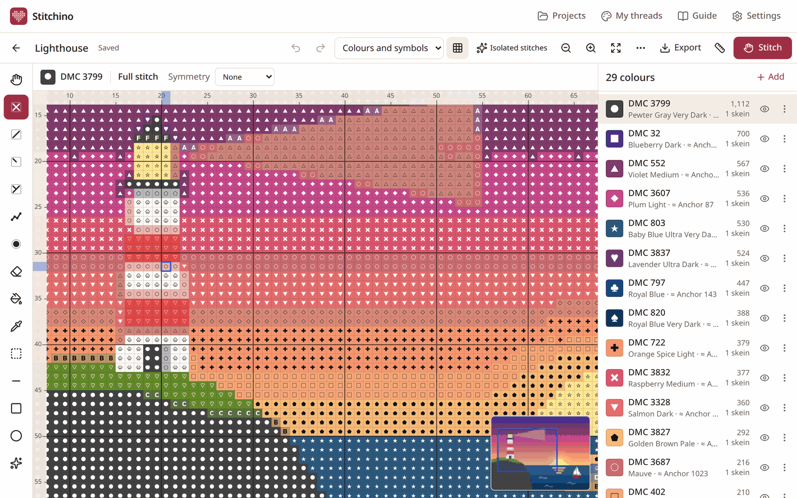
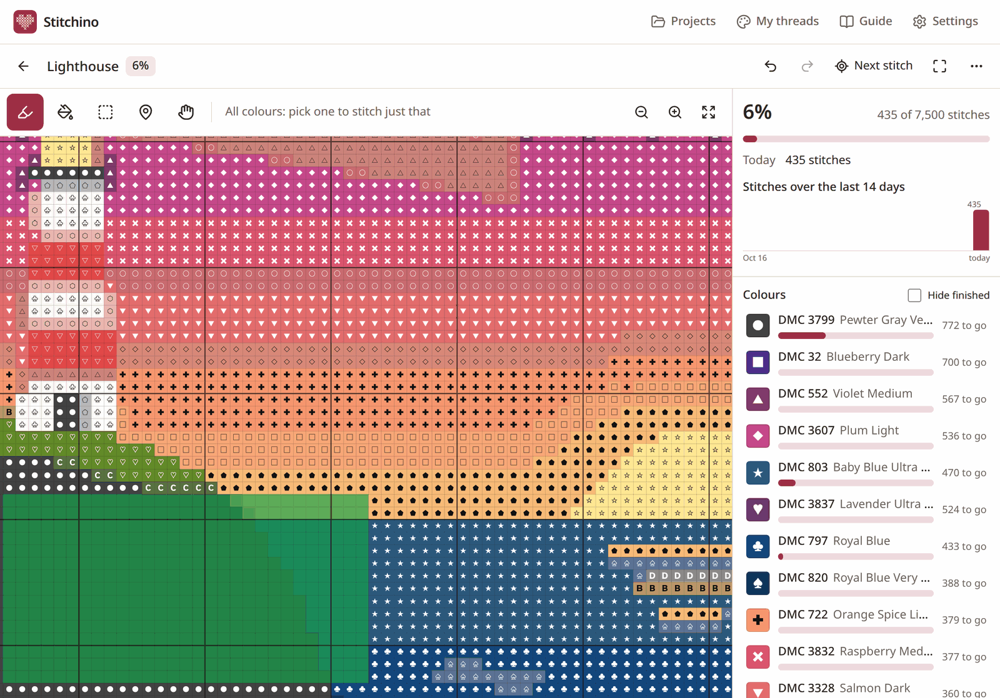
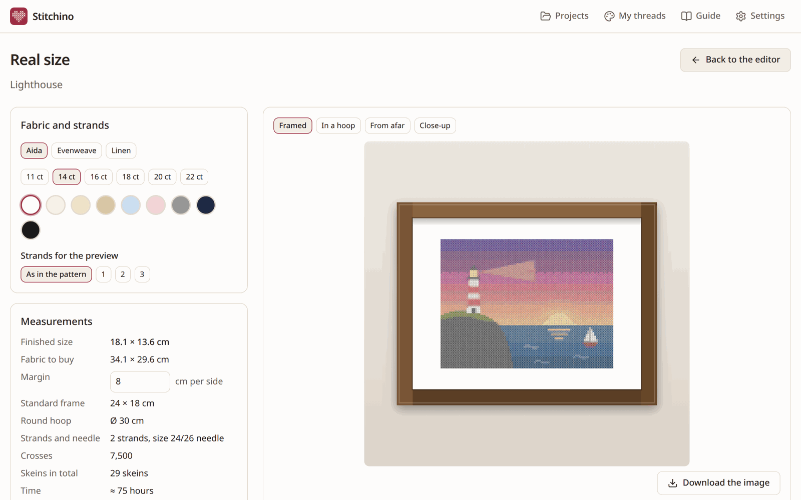
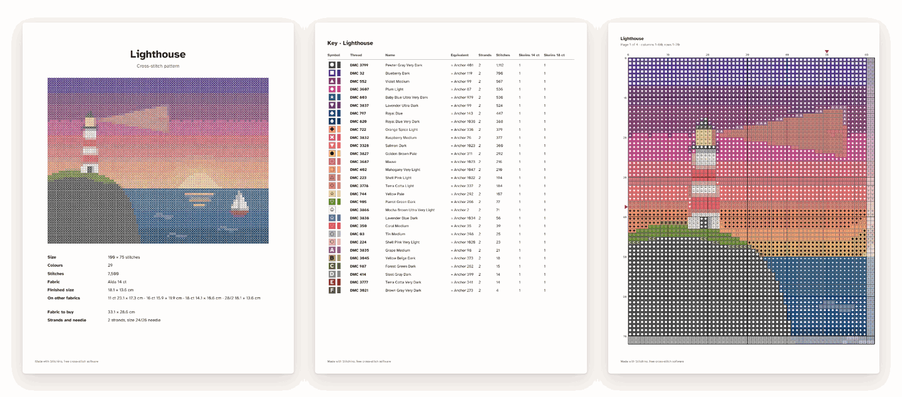

<div align="center">



# Stitchino

**Your photos, stitch by stitch.**

Stitchino turns a photo into a cross-stitch pattern, prints it as a PDF and keeps track of your
stitching. It's free, there's no account, and your pictures never leave your device.

[](https://mrheltic.github.io/stitchino/)

[Free patterns](https://mrheltic.github.io/stitchino/patterns/) · [Guide](https://mrheltic.github.io/stitchino/#/guide) · [Italiano](https://mrheltic.github.io/stitchino/it/schema-punto-croce-da-foto/)

[](https://github.com/mrheltic/stitchino/actions/workflows/ci.yml)
[](package.json)
[](LICENSE)




</div>

## What it does

Pick a photo or a drawing, crop it and say how big the finished piece should be; Stitchino
chooses the DMC or Anchor threads that match it and draws the chart. From there you can fix single
stitches in the editor, print a PDF, or keep the chart open on a tablet and tick stitches off as
you go.

- **Photo to pattern.** Crop, adjust, remove the background with a magic wand, then set the size
  in stitches or centimetres and the number of colours. Threads are matched with CIEDE2000, so
  they're picked by how close they look rather than by RGB distance. Dithering is optional, a
  cleanup pass removes isolated "confetti" stitches, and you choose between three versions.
- **Editor.** Full, half, quarter and three-quarter stitches, backstitch, French knots, text,
  selections, symmetry, colour replace and merge. Everything can be undone and changes save on
  their own.
- **Real size.** The design stitched on Aida, evenweave or linen, framed or in a hoop, with the
  finished size, the fabric to buy, skeins and a shopping list. A 1:1 print has a 5 cm ruler for
  checking your printer's scale.
- **PDF export.** Cover, key with skein counts, a grid every 10 stitches, a page map and repeated
  rows where pages meet, plus a preset for Pattern Keeper. PNG, OXS and project files too.
- **Stitching mode.** Mark stitches with a tap, a drag, a rectangle or a whole area of one colour;
  park threads, jump to the next stitch and see today's count and a likely finish date. The screen
  stays on while you stitch.
- **Thread stash.** A list of the skeins you own, with CSV import and export. The wizard can use
  only those threads or prefer them.
- **Other designers' PDFs.** Charts whose symbols are text (the kind Pattern Keeper reads) can be
  imported and stitched in the app, for personal use, after a review screen that shows what was
  detected.

There's also a small library of [free patterns](https://mrheltic.github.io/stitchino/patterns/)
made with Stitchino, each with PDFs (A4, US Letter, Pattern Keeper) and a button that opens the
picture in the app so you can change the size and colours.

<table>
  <tr>
    <td width="50%"></td>
    <td width="50%"></td>
  </tr>
  <tr>
    <td>Three versions to pick from, with stitch count, difficulty and the hours it'll take.</td>
    <td>The editor: symbols, rulers, palette and a minimap.</td>
  </tr>
  <tr>
    <td></td>
    <td></td>
  </tr>
  <tr>
    <td>Stitching mode on a tablet. Done stitches lose their symbol under a highlighter.</td>
    <td>Real size, with the frame, the fabric to buy and the time it needs.</td>
  </tr>
</table>



<sub>The PDF: cover, key with Anchor equivalents and skein counts, and one of the chart pages.</sub>

## Install it

Stitchino is a web app. Installed from the browser, it gets its own icon and window and works
offline.

<table>
  <tr>
    <td></td>
    <td>Chrome: menu <b>⋮</b> → <b>Install app</b></td>
  </tr>
  <tr>
    <td></td>
    <td>Safari: <b>Share</b> → <b>Add to Home Screen</b></td>
  </tr>
  <tr>
    <td>
      
      
      
      
    </td>
    <td>Chrome or Edge: the install button at the right end of the address bar</td>
  </tr>
</table>

Your projects are saved in the browser, on that device. Make a backup from **Settings** every now
and then; on iPhone and iPad, adding the app to the Home Screen also stops Safari from clearing its
data after a week without visits.

## Privacy

There are no accounts, cookies, analytics or ads. Photos and projects stay in your browser's
storage (IndexedDB) and nothing gets uploaded, because the conversion and the PDF export run on
your device in Web Workers. The site itself is a set of static files on GitHub Pages, which keeps
the usual server logs; see
[GitHub's privacy statement](https://docs.github.com/site-policy/privacy-policies/github-general-privacy-statement).

## Help wanted

Some things can only be checked by people who stitch. If you're one of them:

- open a PDF exported with the **For Pattern Keeper** preset in Pattern Keeper on Android and check
  that the symbols highlight and the counts match;
- compare the skein estimate (about 1,650 stitches per skein on 14-count Aida with 2 strands) with
  a real piece;
- import PDFs from different designers and say which ones fail;
- print the 1:1 page and measure its ruler, which should be exactly 5 cm;
- try it on an iPhone or iPad, where it has barely been tested.

[Open an issue](https://github.com/mrheltic/stitchino/issues) with what you find.

## Development

Stitchino is built with React, Vite and Tailwind CSS, with Radix UI, Zustand, Dexie, Comlink,
pdf-lib and PDF.js doing a lot of the work. You need Node.js 22 or newer.

```sh
npm install
npm run dev        # dev server
npm test           # unit tests (Vitest)
npm run e2e        # end-to-end tests on desktop, tablet and phone (Playwright)
npm run lint && npm run typecheck
npm run build      # production build in dist/
```

Locally the end-to-end tests run in the Chrome you have installed; CI downloads Playwright's
Chromium instead.

The thread catalogues and the symbol font are generated, so rebuild them only when their sources
change:

```sh
npm run build:threads   # src/core/threads/data/*.json from the KXStitch colour schemes
npm run build:font      # public/fonts/pc-symbols.ttf (needs Python 3 with fontTools)
```

| Folder        | Contents                                                                                                                           |
| ------------- | ---------------------------------------------------------------------------------------------------------------------------------- |
| `src/core`    | colour matching, thread catalogues, conversion, sizes, PDF export and import, progress. Plain TypeScript, tested without a browser |
| `src/render`  | canvas drawing: the chart, the stitched preview, mockups                                                                           |
| `src/storage` | IndexedDB through Dexie: projects, progress, inventory, backup                                                                     |
| `src/workers` | photo conversion and PDF export, off the main thread                                                                               |
| `src/ui`      | the React app                                                                                                                      |
| `site`        | landing pages and the free pattern library, generated as plain HTML at build time (see `site/README.md`)                           |

The IndexedDB database and the localStorage keys still carry the working name "puntocroce", so
data saved by the first builds stays readable.

### Publishing your own copy

Fork the repository, enable workflows in the **Actions** tab and set **Settings → Pages → Source**
to **GitHub Actions**. After that, every push to `main` runs the checks and publishes the site at
`https://<user>.github.io/stitchino/`. Paths are relative and routing uses `#`, so it works from
any sub-path. The app name and its links (repository, donation pages) live in `src/core/brand.ts`.

## Supporting the project

Stitchino is free and has no ads. If it's been useful, you can buy me a coffee on Ko-fi or set up
a small recurring donation on Liberapay, which takes no cut.

[](https://ko-fi.com/mrheltic)
[](https://liberapay.com/mrheltic)

Money isn't the only way to help: a star makes the project easier to find, and so does mentioning
it to a stitching group or reporting a bug.

## Licence

The code is under the [GNU GPL v3.0 or later](LICENSE). The symbol font is under the SIL Open Font
Licence 1.1, and the other third-party data and components are listed in
[THIRD_PARTY.md](THIRD_PARTY.md).

DMC and Anchor are trademarks of their owners. Stitchino uses their colour codes only as a
reference and isn't affiliated with either. Colours on screen are approximations of the real
threads.
